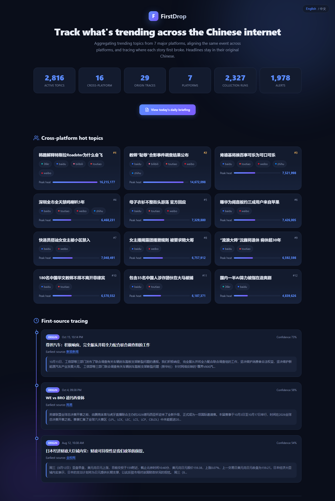
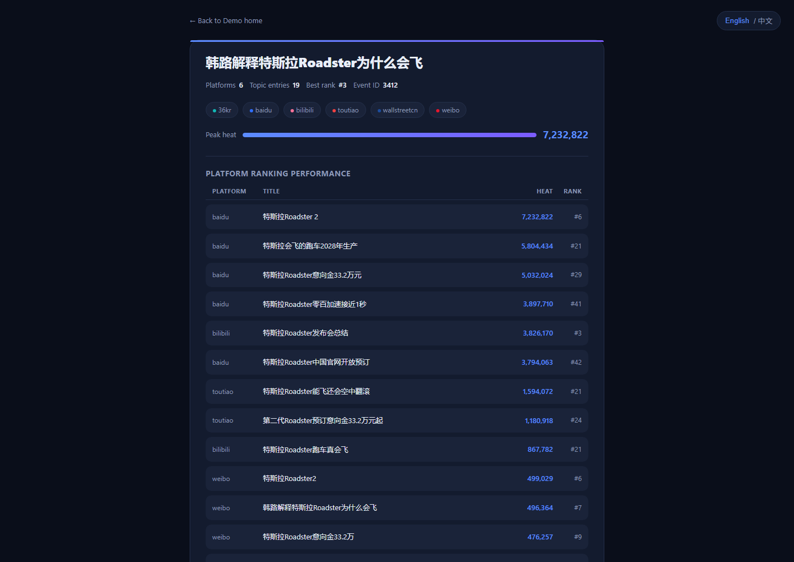
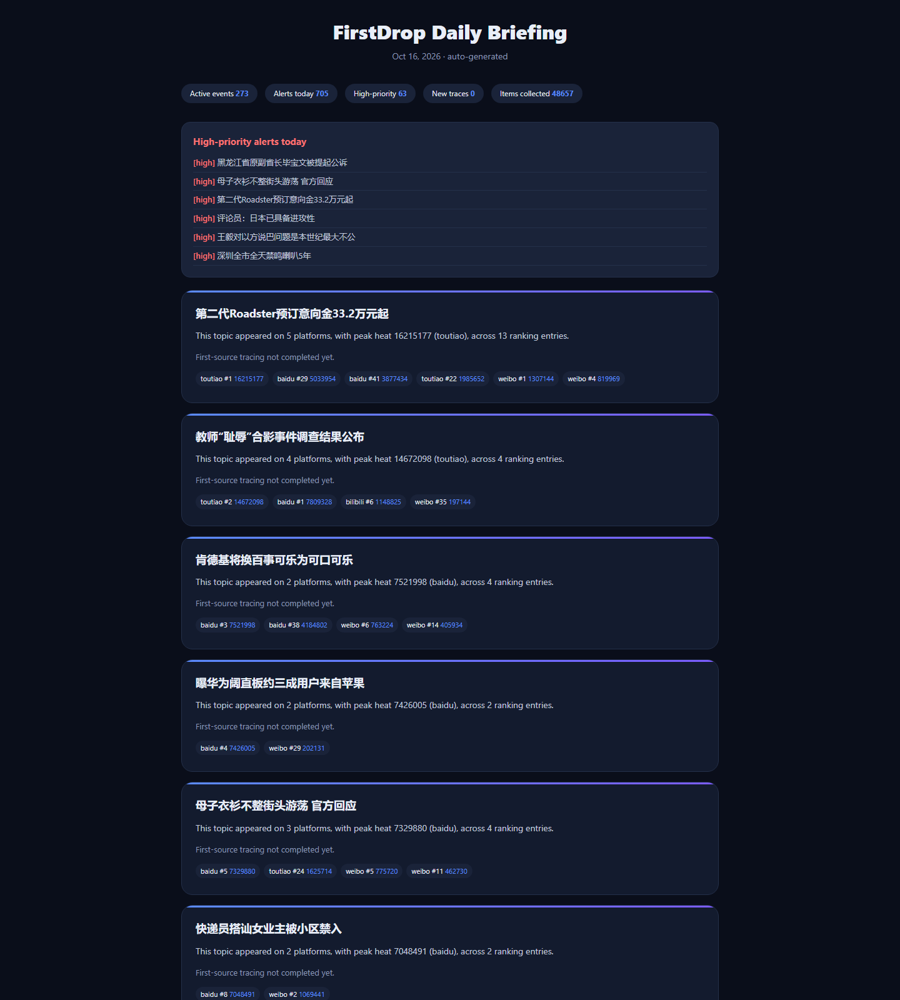

English | [中文](README.zh-CN.md)

# FirstDrop · Real-Time Cross-Platform Trend Aggregation & First-Source Tracing

**Track what's trending across the Chinese internet** — cross-platform aggregation, origin tracing, burst alerts.

FirstDrop aggregates trending topics from 7 major platforms, intelligently aligns the same event across platforms, and traces where each story first broke. Headlines stay in their original Chinese; the surrounding interface is available in English. We don't manufacture information — we only present facts.

## Core Capabilities

- **Real-time collection from 7 platforms**: Weibo, Baidu, Zhihu, Toutiao, Bilibili, 36Kr, Wallstreetcn
- **Cross-platform topic alignment**: the same event is merged automatically (bigram-Jaccard + entity matching + alias dictionary)
- **Entity normalization & fusion**: cross-platform aggregated heat for a single event (dual metrics: peak-based + joint-exposure-based)
- **Trend-spike alerts**: automatically triggered on cross-platform resonance / topping the chart / rank surge / sustained TOP 10
- **First-source tracing**: for each triggered event, locates the earliest known source among covered sources, with a confidence score and a snapshot
- **Daily briefing**: auto-generated HTML/Markdown report in both Chinese and English (LLM optional, rule-based template as fallback)
- **Bilingual UI**: the demo and event-detail pages switch between Chinese and English in one click (English framework, headlines kept in their original Chinese), aimed at an international audience
- **MCP Server**: query trends and event origins directly from Claude / Cursor

## Screenshots

**Demo landing page** — cross-platform trends, topic cards and the first-source timeline at a glance



**Event detail page** — one event's performance across platforms + first-source tracing (source / time / confidence / snapshot)



**Daily briefing** — auto-generated event summaries and per-platform ranking performance (HTML / Markdown)



## Quick Start

```bash
# 1. Install dependencies (Python 3.12+)
pip install -r requirements.txt

# 2. Initialize the database
python -m app.runner --once

# 3. Start the dashboard (admin)
python -m app.web --port 8000
# http://localhost:8000/      -> admin dashboard
# http://localhost:8000/demo  -> public demo landing page

# 4. Start the scheduler (includes the 23:30 daily briefing)
python -m app.runner --schedule --brief
```

## Common Commands

| Command | Description |
|---------|-------------|
| `python -m app.runner --once` | Collect one round from all platforms into the database |
| `python -m app.runner --loop --interval 300` | Collect in a loop (every 300 seconds) |
| `python -m app.runner --schedule` | Scheduled collection at each source's own interval |
| `python -m app.runner --schedule --brief` | Scheduled collection + 23:30 daily briefing |
| `python -m app.runner --report` | Print collection health and ranking reports |
| `python -m app.runner --trace` | Run first-source tracing for triggered events |
| `python -m app.runner --mine` | Automatically mine alias candidates |
| `python -m app.brief` | Manually generate today's daily briefing |
| `python -m app.mcp_server` | Start the MCP Server (stdio) |

## Project Structure

```
firstdrop/
├── app/
│   ├── adapters.py      # Platform adapters (7 trend sources)
│   ├── align.py         # Cross-platform topic alignment (bigram + entity matching)
│   ├── alerts.py        # Trend-spike alert detection
│   ├── brief.py         # Daily briefing generator (LLM optional)
│   ├── config.py        # Data source config loading & sync
│   ├── db.py            # SQLite access layer
│   ├── fuse.py          # Entity normalization & heat fusion
│   ├── mine.py          # Automatic alias-candidate mining
│   ├── pipeline.py      # Unified standard-table construction
│   ├── runner.py        # CLI entry point (collect / schedule / report / trace)
│   ├── scheduler.py     # Scheduled dispatch engine
│   ├── split.py         # Splitting of roundup/aggregated entries
│   ├── trace.py         # Event first-source tracing
│   ├── web.py           # Built-in dashboard service (ThreadingHTTPServer)
│   ├── mcp_server.py    # MCP Server (stdio JSON-RPC)
│   ├── normalize.py     # Title normalization
│   ├── schema.sql       # Database schema
│   └── templates/
│       ├── index.html   # Admin dashboard (config / review / trace actions)
│       ├── demo.html    # Public demo landing page (read-only)
│       └── event.html   # Event detail page (read-only)
├── config/
│   └── sources.toml     # Data source config (enable / interval / retry / daily quota)
├── data/
│   ├── hotspot.db       # SQLite database (WAL mode)
│   ├── snapshots/       # First-source HTML snapshots
│   └── briefs/          # Daily briefings (YYYYMMDD.html/.md; English: YYYYMMDD-en.html/.md)
├── docs/
│   ├── mcp-setup.md     # MCP Server setup guide (EN)
│   ├── mcp-setup.zh-CN.md # MCP Server setup guide (中文)
│   └── images/          # README screenshots
├── Dockerfile
├── docker-compose.yml
├── LICENSE
├── requirements.txt
├── README.md
└── README.zh-CN.md
```

## Environment Variables

| Variable | Description |
|----------|-------------|
| `ADMIN_TOKEN` | Auth token for admin APIs. **When set, all admin GET/POST endpoints require** `Authorization: Bearer <token>` (loopback is no longer exempt — behind a reverse proxy or tunnel, loopback can be bypassed); when unset, admin APIs are reachable only from the local machine directly (requests carrying `CF-Connecting-IP` / `X-Forwarded-For` are treated as external traffic and always get a 403), and the server listens on `127.0.0.1` only |
| `LLM_BRIEF_PROVIDER` | LLM briefing provider: `openai` / `deepseek` / `openrouter` |
| `LLM_BRIEF_API_KEY` | LLM API key |
| `LLM_BRIEF_MODEL` | Model name (auto-selected per provider by default) |
| `LLM_BRIEF_API_BASE` | Custom endpoint (optional) |

## Docker Deployment

```bash
docker compose up --build -d
```

- **web**: dashboard service (port 8000), read-only safe by default — without `ADMIN_TOKEN`, remote write endpoints always return 403.
- **scheduler**: collection scheduling + the 23:30 daily briefing (`--schedule --brief`).
- Both services share the `./data` volume (SQLite / snapshots / briefings). **On first launch, wait one collection cycle (a few minutes by default) before the dashboard has data.**
- Remote admin: run `export ADMIN_TOKEN=$(openssl rand -hex 24)` before `docker compose up -d`; afterwards remote admin calls must carry `Authorization: Bearer <ADMIN_TOKEN>`.
- Data is not baked into the image: `.dockerignore` excludes `data/`, so the database and snapshots are never shipped to image users.

## Data Source Configuration

Edit `config/sources.toml` to enable/disable platforms, adjust collection intervals, and set the daily tracing quota:

```toml
[defaults]
enrich_interval_sec = 600
trace_daily_quota = 60

[[sources]]
code = "weibo"
name = "微博热搜"
adapter = "weibo"
enabled = true
interval_sec = 300
max_retries = 2
retry_delay_sec = 5
sort_order = 1
```

## MCP Integration

See [docs/mcp-setup.md](docs/mcp-setup.md)（[中文](docs/mcp-setup.zh-CN.md)）.

## License

[MIT](LICENSE)
