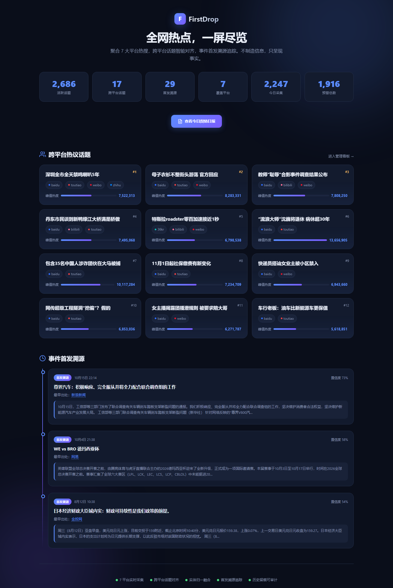
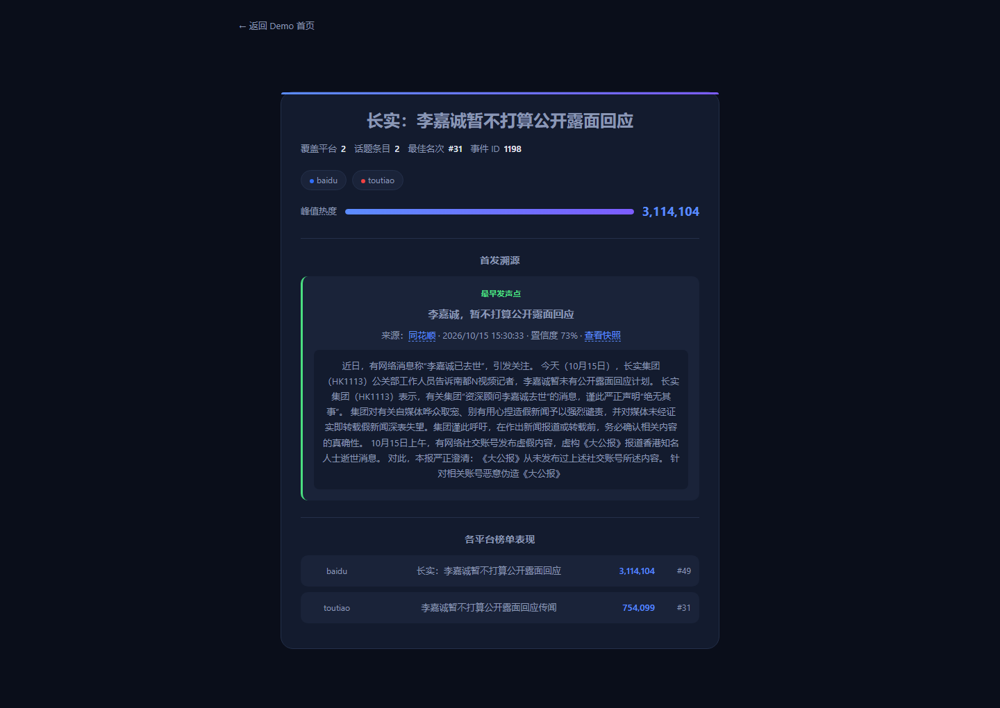
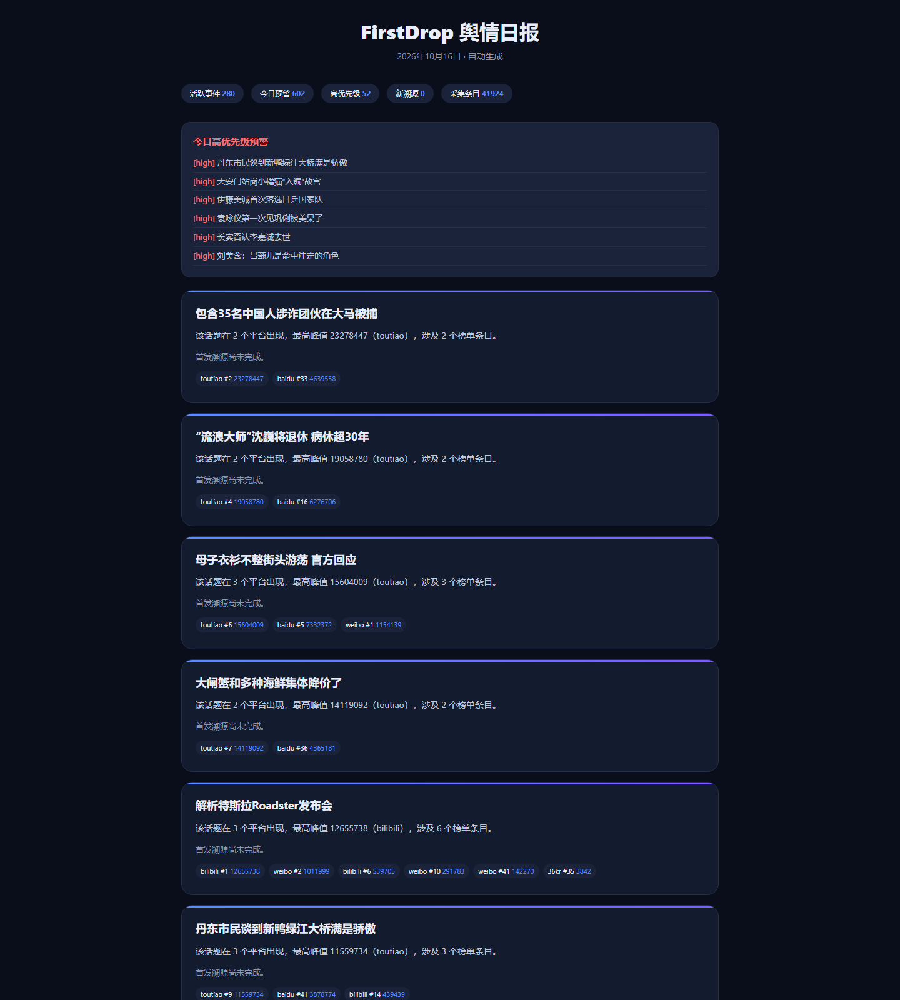

[English](README.md) | 中文

# FirstDrop · 全网热点聚合与首发溯源

聚合 7 大平台热搜，跨平台话题智能对齐，事件首发溯源追踪。不制造信息，只呈现事实。

## 核心能力

- **7 平台实时采集**：微博、百度、知乎、头条、B站、36氪、华尔街见闻
- **跨平台话题对齐**：同一事件自动合并（bigram-Jaccard + 实体匹配 + 别名词典）
- **实体归一融合**：同一事件跨平台聚合热度（峰值式 + 联合曝光式双口径）
- **爆点预警**：跨平台共振 / 榜首 / 名次跃升 / TOP10 持续自动触发
- **首发溯源**：对触发事件检索「已覆盖源中最早的发声点」，附置信度与快照
- **每日舆情简报**：自动生成中英双份 HTML/Markdown 日报（LLM 可选，规则模板兜底）
- **中英双语界面**：Demo 页与事件详情页支持中/英一键切换（界面框架英文、事件标题保留中文原文），面向国际受众
- **MCP Server**：Claude/Cursor 直接查询热点与事件首发

## 界面预览

**Demo 落地页** — 一屏总览跨平台热点、话题卡片与首发溯源时间线



**事件详情页** — 单一事件在各平台的表现 + 首发溯源（来源 / 时间 / 置信度 / 快照）



**每日舆情日报** — 自动生成的事件摘要与各平台榜单表现（HTML / Markdown 双格式）



## 快速开始

```bash
# 1. 安装依赖（Python 3.12+）
pip install -r requirements.txt

# 2. 初始化数据库
python -m app.runner --once

# 3. 启动看板（管理后台）
python -m app.web --port 8000
# 访问 http://localhost:8000/      → 管理看板
# 访问 http://localhost:8000/demo   → 公开 Demo 落地页

# 4. 启动定时调度（含每日 23:30 简报）
python -m app.runner --schedule --brief
```

## 常用命令

| 命令 | 说明 |
|------|------|
| `python -m app.runner --once` | 采集一轮全部平台并入库 |
| `python -m app.runner --loop --interval 300` | 循环采集（每 300 秒） |
| `python -m app.runner --schedule` | 按数据源独立间隔定时调度 |
| `python -m app.runner --schedule --brief` | 定时调度 + 每日 23:30 简报 |
| `python -m app.runner --report` | 打印采集健康度与榜单报表 |
| `python -m app.runner --trace` | 对已触发事件执行首发溯源 |
| `python -m app.runner --mine` | 自动挖掘别名候选 |
| `python -m app.brief` | 手动生成今日舆情日报 |
| `python -m app.mcp_server` | 启动 MCP Server（stdio） |

## 项目结构

```
firstdrop/
├── app/
│   ├── adapters.py      # 平台适配器（7 个热搜源）
│   ├── align.py         # 跨平台话题对齐（bigram + 实体匹配）
│   ├── alerts.py        # 爆点预警检测
│   ├── brief.py         # 舆情日报生成器（LLM 可选）
│   ├── config.py        # 数据源配置加载与同步
│   ├── db.py            # SQLite 访问层
│   ├── fuse.py          # 实体归一与热度融合
│   ├── mine.py          # 别名候选自动挖掘
│   ├── pipeline.py      # 统一标准表构建
│   ├── runner.py        # CLI 入口（采集/调度/报表/溯源）
│   ├── scheduler.py     # 定时调度引擎
│   ├── split.py         # 盘点聚合条目拆分
│   ├── trace.py         # 事件首发溯源
│   ├── web.py           # 内置看板服务（ThreadingHTTPServer）
│   ├── mcp_server.py    # MCP Server（stdio JSON-RPC）
│   ├── normalize.py     # 标题归一化
│   ├── schema.sql       # 数据库 schema
│   └── templates/
│       ├── index.html   # 管理看板（含配置/审核/溯源操作）
│       ├── demo.html    # 公开 Demo 落地页（只读）
│       └── event.html   # 事件详情只读页
├── config/
│   └── sources.toml     # 数据源配置（开关/间隔/重试/每日预算）
├── data/
│   ├── hotspot.db       # SQLite 数据库（WAL 模式）
│   ├── snapshots/       # 首发溯源 HTML 快照
│   └── briefs/          # 舆情日报（YYYYMMDD.html/.md；英文版 YYYYMMDD-en.html/.md）
├── docs/
│   ├── mcp-setup.md     # MCP Server 接入指南（英文）
│   ├── mcp-setup.zh-CN.md # MCP Server 接入指南（中文）
│   └── images/          # README 界面截图
├── Dockerfile
├── docker-compose.yml
├── LICENSE
├── requirements.txt
├── README.md
└── README.zh-CN.md
```

## 环境变量

| 变量 | 说明 |
|------|------|
| `ADMIN_TOKEN` | 管理接口鉴权 token。**配置后所有管理类 GET/POST 强制校验** `Authorization: Bearer <token>`（不再对 loopback 放行——反代/隧道场景下 loopback 会被旁路）；未配置时仅直接本机可访问管理接口（带 `CF-Connecting-IP` / `X-Forwarded-For` 代理头的请求视为外部流量，一律 403），且服务默认仅监听 `127.0.0.1` |
| `LLM_BRIEF_PROVIDER` | LLM 简报 provider：`openai` / `deepseek` / `openrouter` |
| `LLM_BRIEF_API_KEY` | LLM API Key |
| `LLM_BRIEF_MODEL` | 模型名（缺省按 provider 自动选择） |
| `LLM_BRIEF_API_BASE` | 自定义 endpoint（可选） |

## Docker 部署

```bash
docker compose up --build -d
```

- **web**：看板服务（8000 端口），默认只读安全——未配置 `ADMIN_TOKEN` 时远程写接口一律 403。
- **scheduler**：采集调度 + 每日 23:30 简报（`--schedule --brief`）。
- 两个服务共享 `./data` volume（SQLite / 快照 / 简报）。**首次启动后需等一个采集周期（默认几分钟）看板才有数据。**
- 远程管理：`export ADMIN_TOKEN=$(openssl rand -hex 24)` 后再 `docker compose up -d`，之后远程调用管理接口需携带 `Authorization: Bearer <ADMIN_TOKEN>`。
- 数据不打包进镜像：`.dockerignore` 已排除 `data/`，避免把数据库与快照分发给镜像使用者。

## 数据源配置

编辑 `config/sources.toml` 即可开关平台、调整采集间隔、配置溯源每日预算：

```toml
[defaults]
enrich_interval_sec = 600
trace_daily_quota = 60

[[sources]]
code = "weibo"
name = "微博热搜"
adapter = "weibo"
enabled = true
interval_sec = 300
max_retries = 2
retry_delay_sec = 5
sort_order = 1
```

## MCP 接入

详见 [docs/mcp-setup.zh-CN.md](docs/mcp-setup.zh-CN.md)（[English](docs/mcp-setup.md)）。

## License

[MIT](LICENSE)
